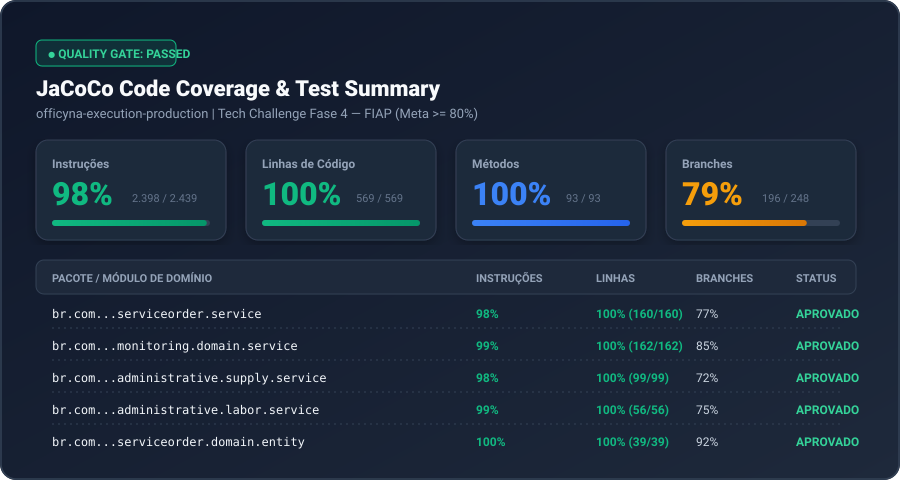

# ⚙️ Production Execution Service

> **Officyna — Microsserviço de Diagnóstico e Execução de Ordens de Serviço**

O **`production-execution-service`** é responsável pelo diagnóstico e pela execução das Ordens de Serviço (OS), incluindo os catálogos de labor e supply, controle de estoque e monitoring.

O `os-service` permanece como fonte oficial dos dados e itens da OS. Este microsserviço coordena o fluxo de execução e encaminha as alterações da OS por REST. O `billing-service` é responsável pelas decisões de aprovação e pagamento.

---

## 📋 Sumário

- [Responsabilidades](#-responsabilidades)
- [Fluxo de Execução](#-fluxo-de-execução)
- [Endpoints](#-endpoints)
- [Integração por Eventos](#-integração-por-eventos)
- [Persistência](#-persistência)
- [Execução Local](#-execução-local)
- [Infraestrutura e Deploy](#-infraestrutura-e-deploy)
- [Monitoramento e Qualidade](#-monitoramento-e-qualidade)

---

> 📖 **Documentação de Arquitetura Completa:** Consulte [docs/ARQUITETURA.md](docs/ARQUITETURA.md) para o detalhamento aprofundado dos padrões DDD, Clean Architecture, Saga distribuída, resiliência e modelo NoSQL poliglota.


## 🎯 Responsabilidades

- **Diagnóstico:** recebe novas OSs e controla o início e a conclusão do diagnóstico.
- **Execução:** coordena o início da OS e o início/fim dos serviços realizados pelos mecânicos.
- **Labor e Supply:** mantém os catálogos próprios e encaminha a inclusão/remoção de itens da OS ao `os-service`.
- **Estoque:** realiza reservas e consumo de insumos durante o fluxo de execução.
- **Monitoring:** registra os tempos de execução dos serviços e calcula médias de duração.

> **Responsabilidade dos dados:** os itens e os dados oficiais da OS pertencem ao `os-service`. Este serviço mantém apenas o snapshot operacional necessário à execução.

---

## 🔄 Fluxo de Execução

1. **Recebimento da OS:** a fila `eventForDiagnostics` envia a OS para este serviço, que persiste o snapshot com status `RECEBIDA`. O recebimento do evento não inicia o diagnóstico.
2. **Início do diagnóstico:** `POST /execution/{id}/diagnosis/start` registra o mecânico, a data e o status `EM_DIAGNOSTICO`, e publica `eventDiagnosis`.
3. **Preparação da OS:** inclusão e remoção de labor e supply, assim como alterações de informações, são encaminhadas ao `os-service` por REST.
4. **Solicitação de aprovação:** `POST /execution/{id}/submit-for-approval` reserva os insumos, atualiza o status para `AGUARDANDO_APROVACAO` e publica `eventDiagnosisCompleted`.
5. **Retorno da aprovação:** a mensagem recebida em `productionApproval` atualiza o snapshot local e mantém a reserva de estoque quando aprovada. O estado oficial da OS continua pertencendo ao `os-service`.
6. **Início da execução:** o início da OS ou do primeiro labor atualiza o status para `EM_EXECUCAO`, consome a reserva e notifica o `os-service`.
7. **Monitoring:** início e fim de cada labor são encaminhados ao `os-service`; os horários retornados alimentam o histórico local.
8. **Conclusão:** `POST /execution/{id}/finish` valida as execuções dos labors, atualiza a OS para `FINALIZADA` no `os-service` e publica `eventForOsCompleted`.

O `correlationId` recebido no atributo da mensagem SQS é mantido no snapshot e propagado nas mensagens publicadas.

---

## 🌐 Endpoints

Todos os endpoints de negócio exigem autenticação via **Bearer JWT**. Swagger e `/actuator/health` são públicos.

| Método | Endpoint | Descrição |
|---|---|---|
| `GET` | `/execution` | Lista OSs ativas por prioridade/data |
| `GET` | `/execution/{id}` | Consulta o snapshot da execução |
| `POST` | `/execution/{id}/diagnosis/start` | Inicia o diagnóstico |
| `POST` | `/execution/{id}/labors` | Adiciona labor à OS |
| `DELETE` | `/execution/{id}/labors/{laborId}` | Remove labor da OS |
| `POST` | `/execution/{id}/supplies` | Adiciona supply à OS |
| `DELETE` | `/execution/{id}/supplies/{supplyId}` | Remove supply da OS |
| `PUT` | `/execution/{id}/information` | Atualiza informações da OS |
| `POST` | `/execution/{id}/submit-for-approval` | Conclui diagnóstico e solicita aprovação |
| `POST` | `/execution/{id}/start` | Inicia a execução da OS |
| `POST` | `/execution/{id}/labors/{laborId}/start` | Inicia um labor |
| `POST` | `/execution/{id}/labors/{laborId}/finish` | Finaliza um labor e registra o monitoring |
| `POST` | `/execution/{id}/finish` | Finaliza a OS |
| `GET` | `/api/monitoring/labors` | Consulta médias de duração |
| `PUT` | `/api/monitoring/force-recalc` | Recalcula médias com base no histórico |

As operações de labor, supply e informações da OS são encaminhadas ao `os-service`, utilizando o mesmo Bearer JWT recebido na requisição.

---

## 📨 Integração por Eventos

A comunicação assíncrona utiliza **Amazon SQS e SNS**.

### Eventos recebidos

| Fila/Tópico | Finalidade |
|---|---|
| `eventForDiagnostics` | Recebe uma OS para iniciar o fluxo de diagnóstico |
| `productionApproval` | Recebe o resultado da aprovação |

### Eventos publicados

| Evento | Finalidade |
|---|---|
| `eventDiagnosis` | Informa o início do diagnóstico |
| `eventDiagnosisCompleted` | Informa a conclusão do diagnóstico e solicita aprovação |
| `eventExecutionStarted` | Notifica o início da execução |
| `eventForOsCompleted` | Notifica a conclusão da OS |

O `correlationId` é enviado como atributo da mensagem SQS. Os contratos utilizam somente os dados necessários para cada etapa; labor, supply, orçamento e informações de diagnóstico não são transportados nesses eventos.

A fila `eventForDiagnostics` e sua DLQ são criadas pelo deploy deste microsserviço. As demais filas, tópicos, assinaturas SNS→SQS e DLQs pertencem à infraestrutura compartilhada.

---

## 🗄️ Persistência

A aplicação utiliza **três bancos lógicos no mesmo cluster MongoDB e MongoClient**:

| Banco | Collections |
|---|---|
| `officyna_supply` | `supplies`, `stock_movements` |
| `officyna_labor` | `labors`, `labor_monitoring`, `labor_executions` |
| `officyna_snapshot` | `execution_work` |

A collection `execution_work` mantém o snapshot operacional da OS: identificador, status, mecânico, `correlationId`, datas das transições e informações de reserva/consumo de estoque.

Os itens de labor e supply da OS não são duplicados nesse snapshot; o `os-service` continua sendo o responsável pelos dados oficiais.

**Requisito:** as transações utilizam a mesma sessão MongoDB entre os três bancos lógicos. O ambiente MongoDB/DocumentDB deve oferecer suporte às transações utilizadas e operar com a configuração de cluster/replica set adequada.

---

## 🚀 Execução Local

### Pré-requisitos

- **Java 21**
- **Docker e Docker Compose**
- Credenciais AWS ou role com permissões necessárias para SQS
- Arquivo `.env` configurado a partir de `.env.example`

### Executar testes e validações

```bash
./mvnw verify
```

### Subir a aplicação e dependências

```bash
docker compose up --build
```

O Docker Compose inicializa o MongoDB com replica set e publica a aplicação na porta **8084**.

Para utilizar um MongoDB externo ao Compose, configure um replica set com hostname acessível pela JVM. O hostname `mongodb` anunciado pelo Compose é destinado à comunicação entre containers.

### Configurações importantes

| Variável | Finalidade |
|---|---|
| `OS_SERVICE_BASE_URL` | URL base do `os-service` no ambiente local |
| `OS_SERVICE_BASE_URL_PARAMETER` | Parâmetro SSM usado pelo deploy para obter a URL do `os-service` |

No deploy, o workflow consulta o parâmetro SSM configurado em `OS_SERVICE_BASE_URL_PARAMETER` (padrão: `/officyna/os-service/base-url`) e injeta a URL no ConfigMap. A infraestrutura deve atualizar esse parâmetro após criar ou substituir o ELB do `os-service`.

### Acesso à Documentação da API
* **Swagger UI Local:** `http://localhost:8080/swagger-ui.html`
* **Swagger UI no K8s:** `https://{dns-elb}.us-east-1.elb.amazonaws.com/swagger-ui/index.html`
* **Collection Postman**: [docs/Officyna_Execution_Prodution_Service](docs/Officyna_Execution_Prodution_Service.postman_collection.json)
---

## ☁️ Infraestrutura e Deploy

Este repositório é responsável por construir/publicar a imagem da aplicação e aplicar seus recursos Kubernetes:

- `Deployment`
- `Service` do tipo `LoadBalancer`
- `HPA`
- `ServiceAccount`
- `ConfigMap`
- `Secrets`

O cluster EKS, node groups, rede, addons compartilhados, roles e políticas IAM são mantidos pelo repositório de infraestrutura.

Durante o deploy, o workflow conecta-se ao cluster existente, consulta o endpoint do DocumentDB no SSM e executa o rollout da aplicação. A AWS provisiona o endpoint público do Service `LoadBalancer`.

Cada deploy utiliza uma tag de imagem imutável baseada no SHA do commit. As tags `developer` e `latest` permanecem disponíveis como referências, mas não definem a versão aplicada ao Kubernetes.

---

## 📊 Monitoramento e Qualidade

### New Relic

A aplicação mantém a instrumentação New Relic com:

- Nome da aplicação configurado para o microsserviço.
- License key fornecida exclusivamente por variável de ambiente.
- Logs estruturados em JSON com `message` e `correlationId`.
- Eventos de mudança de status e métricas de duração.
- Métricas HTTP do Spring Boot Actuator e filtros de correlação.

Os identificadores de monitoring preservados são `SERVICE_ORDER_STATUS_CHANGED` e `SERVICE_ORDER_STATUS_DURATION`. O cálculo de média de labor considera um dia de trabalho de **8 horas**.

### Sonar

Acesse a análise de qualidade e os indicadores do projeto:

**[Sonar — production-execution-service](https://sonarcloud.io/project/overview?id=Officyna_officyna-execution-production)**

---

### Dashboard de Cobertura JaCoCo



---

### Resumo Geral de Cobertura

Os números consolidados gerados pelo JaCoCo a partir da execução da suíte completa de testes:

| Métrica | Total no Projeto | Itens Cobertos | Cobertura (%) | Meta FIAP | Status |
|---|---|---|:---:|:---:|:---:|
| **Instruções (Bytecode)** | 2.439 | 2.398 | **98%** | ≥ 80% | 🟢 **Aprovado** |
| **Linhas de Código** | 569 | 569 | **100%** | ≥ 80% | 🟢 **Aprovado** |
| **Métodos** | 93 | 93 | **100%** | ≥ 80% | 🟢 **Aprovado** |
| **Classes de Domínio** | 15 | 15 | **100%** | ≥ 80% | 🟢 **Aprovado** |
| **Branches de Decisão** | 248 | 196 | **79%** | — | 🟢 **Aprovado** |
| **Complexidade Ciclomática** | 230 | 179 | **78%** | — | 🟢 **Aprovado** |

---
