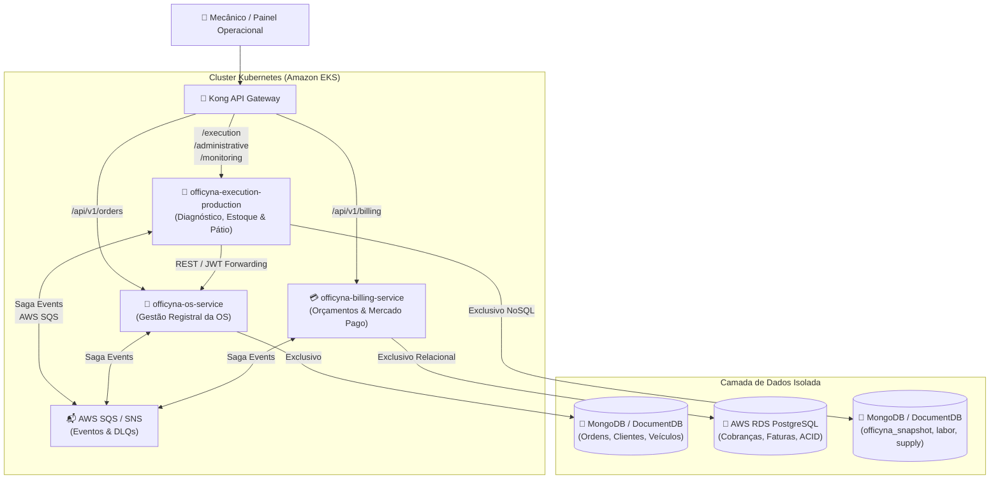
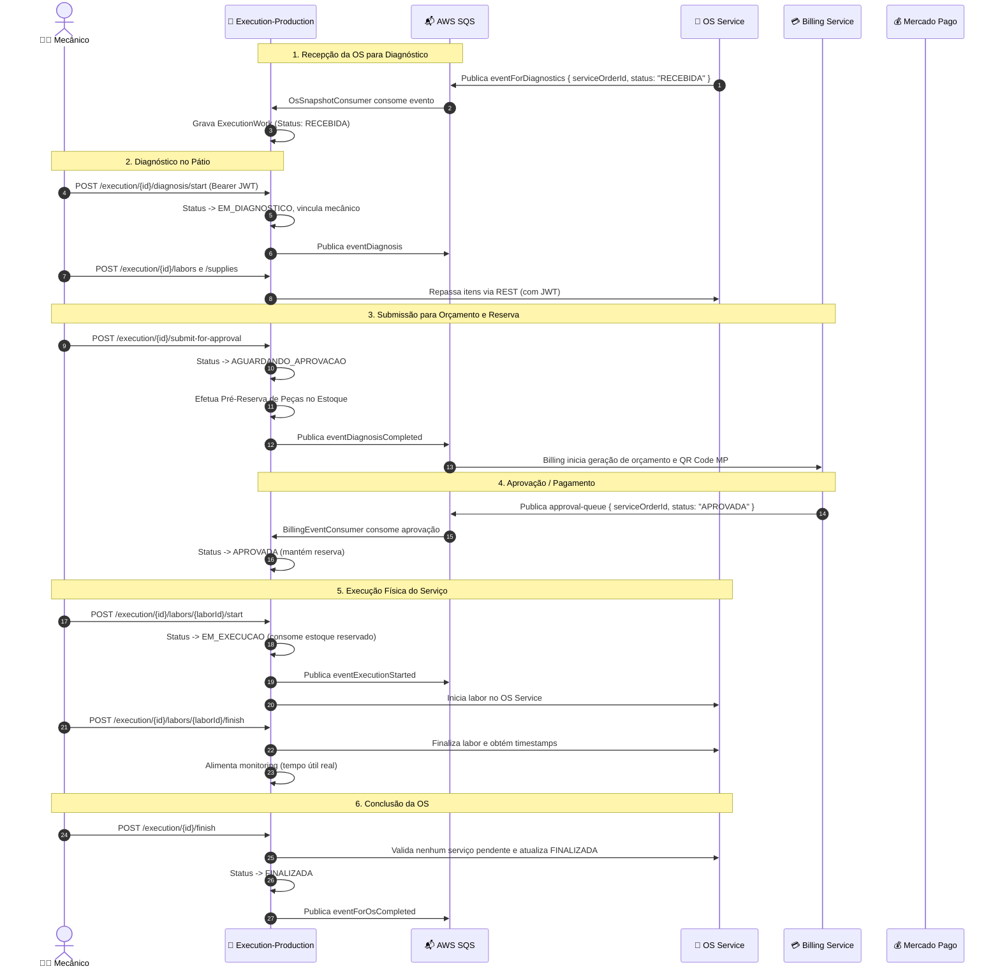
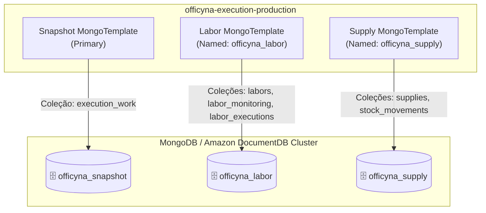
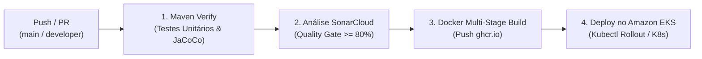

# 🏛️ Documento de Arquitetura de Software — officyna-execution-production

**Projeto:** Sistema Officyna — Tech Challenge Fase 4 (FIAP)  
**Microsserviço:** `officyna-execution-production` (Production Execution Service)  
**Versão:** 4.0.0  
**Stack Principal:** Java 21, Spring Boot 3.3.4, MongoDB (Amazon DocumentDB), AWS SQS / SNS, New Relic, Kubernetes (Amazon EKS)

---

## 📑 Índice

1. [Introdução e Visão Geral](#1-introdução-e-visão-geral)
2. [Arquitetura de Microsserviços e Contexto Delimitado](#2-arquitetura-de-microsserviços-e-contexto-delimitado)
3. [Padrão Arquitetural Interno (Clean Architecture & Ports and Adapters)](#3-padrão-arquitetural-interno-clean-architecture--ports-and-adapters)
4. [Gestão Transacional Distribuída (Saga Pattern & Compensações)](#4-gestão-transacional-distribuída-saga-pattern--compensações)
5. [Estratégia de Persistência Poliglota: Três Bancos NoSQL](#5-estratégia-de-persistência-poliglota-três-bancos-nosql)
6. [Segurança e Autenticação Stateless (Resource Server)](#6-segurança-e-autenticação-stateless-resource-server)
7. [Contratos de Comunicação e Mensageria](#7-contratos-de-comunicação-e-mensageria)
8. [Observabilidade, Rastreamento e Métricas de Produtividade](#8-observabilidade-rastreamento-e-métricas-de-produtividade)
9. [Infraestrutura, Implantação e CI/CD](#9-infraestrutura-implantação-e-cicd)

---

## 1. Introdução e Visão Geral

O **`officyna-execution-production`** é o microsserviço encarregado do **chão de oficina (pátio mecânico)** dentro da plataforma de gestão automotiva **Officyna**. Originado da decomposição modular do monólito legado durante a transição da Fase 3 para a Fase 4, este serviço isola as responsabilidades operacionais e físicas do negócio:
- Recepção e fila de triagem técnica das Ordens de Serviço (OS);
- Apontamento e controle da alocação de mecânicos e realização do diagnóstico;
- Catálogos autônomos de serviços (`labor`) e peças/insumos (`supply`);
- Gestão de estoque com pré-reserva, liberação e consumo atômico;
- Telemetria de produtividade técnica (`monitoring`), medindo tempo médio real gasto por tarefa.

O microsserviço opera de forma desacoplada: **o `os-service` é o dono registral da OS e seus itens**, enquanto o **`officyna-execution-production`** orquestra o ciclo de vida físico, interagindo por eventos assíncronos e chamadas REST autorizadas.

---

## 2. Arquitetura de Microsserviços e Contexto Delimitado

A decomposição da Fase 4 adotou os conceitos do **Domain-Driven Design (DDD)** e a diretriz estrita de **Database-per-Service**:



### Limites e Responsabilidades

| Dimensão | `officyna-os-service` | `officyna-billing-service` | `officyna-execution-production` (Este Serviço) |
|---|---|---|---|
| **Domínio Central** | Agregado raiz da OS, dados cadastrais de clientes e veículos. | Orçamentos formais, aprovações, faturamento e Pix Mercado Pago. | Diagnóstico no box, catálogo de peças/mão de obra, estoque e apontamentos. |
| **Banco de Dados** | MongoDB (NoSQL) | PostgreSQL (SQL ACID) | MongoDB / DocumentDB (NoSQL segregado em 3 esquemas) |
| **Gatilhos** | Abertura de OS pelo cliente/atendente. | Notificação de diagnóstico concluído. | Evento `eventForDiagnostics` ou comando direto do mecânico. |

---

## 3. Padrão Arquitetural Interno (Clean Architecture & Ports and Adapters)

O código adota a **Arquitetura Limpa (Clean Architecture)** associada ao modelo **Hexagonal (Ports and Adapters)**, garantindo que regras de negócio não dependam de frameworks, bibliotecas de terceiros ou tecnologia de banco:

```
src/main/java/br/com/officyna_execution_production/
 ├── administrative/                    # Módulo Administrativo
 │    ├── labor/                        # Catálogo de Mão de Obra
 │    │    ├── api/                     # Driving Adapters (REST Controllers, DTOs, Handlers)
 │    │    └── domain/                  # Entidades de Domínio, Exceções e Serviços
 │    └── supply/                       # Catálogo de Peças e Gestão de Estoque
 │         ├── api/                     # REST Controllers e DTOs de Insumos/Estoque
 │         └── domain/                  # Entidades, Regras de Movimentação e Serviços
 ├── monitoring/                        # Módulo de Produtividade Operacional
 │    ├── api/                          # Endpoints de consulta e recalculo de médias
 │    ├── domain/                       # Cálculos de tempo útil, média histórica e entidades
 │    └── infrastructure/persistence/   # Repositórios de persistência de execuções
 ├── serviceorder/                      # Core de Execução da Ordem de Serviço
 │    ├── api/                          # Controllers de transição de status da OS no box
 │    ├── consumer/                     # Driving Adapters SQS (Consumidores de Eventos & DLQs)
 │    ├── domain/                       # Aggregate Root ExecutionWork, Máquina de Estados, Enums
 │    │    ├── entity/                  # ExecutionWork e itens de reserva
 │    │    ├── enums/                   # ServiceOrderStatus, prioridades operacionais
 │    │    ├── exception/               # Exceções de negócio (400) e não encontrado (404)
 │    │    └── repository/              # Portas de Saída (ExecutionWorkRepository)
 │    ├── event/                        # Modelos de eventos do Saga
 │    ├── infrastructure/persistence/   # Driven Adapters MongoDB (Gateways, Mappers, Repositories)
 │    └── service/                      # Casos de Uso (ServiceOrderExecutionService, Publishers)
 └── infrastructure/                    # Framework Wiring & Cross-Cutting
      ├── auth/ & security/             # Stateless JWT Security Filter & AuthenticatedUserDetails
      ├── config/                       # MongoDatabaseConfig, SQS Config, RestClientConfig
      ├── logging/                      # CorrelationId, MDC Filter e New Relic Tracing
      └── persistence/mongodb/          # Gateways genéricos e conversores de data/hora
```

### Componentes Principais

1. **`ExecutionWork` (Aggregate Root)**: Mantém o estado operacional local, flags de reserva e consumo de estoque, datas de transição de status, mecânico alocado e o `correlationId`. Não duplica listas inteiras de itens do cliente ou dados de faturamento.
2. **`ServiceOrderExecutionService` (Caso de Uso Central)**: Orquestra todas as transições de status da OS no chão de fábrica, validações de pré-requisitos, reservas e liberações de estoque, chamadas síncronas ao `os-service` e disparo de eventos.
3. **`ExecutionPublisher` (Driven Adapter SQS)**: Publica eventos com garantia de integridade, amarrado ao `afterCommit` do `MongoTransactionManager`.
4. **`OsServiceClient` (Driven Adapter REST)**: Comunica com o `os-service` repassando o mesmo Bearer JWT do usuário, mantendo auditoria e RBAC intactos.

---

## 4. Gestão Transacional Distribuída (Saga Pattern & Compensações)

O microsserviço atua como peça fundamental na **Saga Coreografada** do ciclo de vida da OS:



### Matriz de Compensação e Resiliência (Rollback Distribuído)

Em conformidade com o padrão Saga, falhas parciais acionam transações compensatórias automáticas via Dead Letter Queues (DLQ) ou eventos de recusa:

| Ponto de Falha / Evento | Gatilho de Compensação | Consumidor Responsável | Ação de Compensação Executada | Status Resultante |
|---|---|---|---|:---:|
| **Falha no início do diagnóstico** | Mensagem vai para `eventDiagnosisDlq` | `SagaCompensationConsumer` | Desvincula mecânico, zera data de início e reverte snapshot | `RECEBIDA` |
| **Falha na submissão de aprovação** | Mensagem vai para `eventDiagnosisCompletedDlq` | `SagaCompensationConsumer` | **Libera peças reservadas no estoque**, remove flag de reserva | `EM_DIAGNOSTICO` |
| **Cliente Rejeita Orçamento** | Evento `eventServiceOrderRecused` | `SagaCompensationConsumer` | **Estorno imediato das reservas de estoque**, registra data de recusa | `RECUSADA` |
| **Pagamento Recusado / Cancelado** | `approval-queue` com status `RECUSADA` | `BillingEventConsumer` | **Libera insumos reservados**, transiciona status local | `RECUSADA` |

### Garantia de Entrega Atômica (Dual-Write Protection)

Para impedir inconsistência entre banco de dados e mensageria (ex: banco gravou, mas aplicação caiu antes de enviar ao SQS; ou SQS enviou e banco falhou):
- As gravações no MongoDB utilizam `MongoTransactionManager`;
- A classe `ExecutionPublisher` registra um hook de sincronização via `TransactionSynchronizationManager.registerSynchronization`;
- **O envio ao SQS só ocorre no evento `afterCommit()`**. Se houver rollback na transação do MongoDB, **nenhuma mensagem é publicada**.

---

## 5. Estratégia de Persistência Poliglota: Três Bancos NoSQL

Para atender aos requisitos de segregação de dados e alto desempenho no acesso às coleções, a aplicação adota **três bancos lógicos independentes** hospedados no mesmo cluster MongoDB / Amazon DocumentDB:



### Detalhamento das Bases e Coleções

1. **`officyna_snapshot` (Banco de Execução)**:
   - Coleção `execution_work`: Snapshot da OS em andamento, `_id` mapeado para o `serviceOrderId` (garantindo idempotência contra mensagens duplicadas do SQS), status, datas de cada etapa, lista de insumos reservados e correlationId.
2. **`officyna_labor` (Banco de Mão de Obra e Produtividade)**:
   - Coleção `labors`: Catálogo de serviços técnicos oferecidos (descrição, tempo estimado, valor hora).
   - Coleção `labor_monitoring`: Médias históricas consolidadas por tipo de serviço.
   - Coleção `labor_executions`: Histórico pontual de cada apontamento (data início, data fim, tempo em minutos úteis).
3. **`officyna_supply` (Banco de Peças e Estoque)**:
   - Coleção `supplies`: Cadastro de itens/peças (nome, descrição, preço de venda, saldo disponível).
   - Coleção `stock_movements`: Livro-razão (ledger) de movimentações (`ENTRADA`, `SAIDA`, `RESERVA`, `LIBERACAO`, `CONSUMO`).

---

## 6. Segurança e Autenticação Stateless (Resource Server)

Em conformidade com a arquitetura definida para a Fase 4:
- O microsserviço **não possui banco de usuários e não utiliza `UserDetailsService`**;
- Atua como um **Stateless Resource Server**, validando tokens JWT assinados pelo IdP central;
- O filtro `JwtAuthenticationFilter` intercepta cada requisição HTTP, valida a assinatura criptográfica e tempo de expiração em memória, e popula o `SecurityContextHolder` com `AuthenticatedUserDetails`;
- **Propagação de Contexto**: As credenciais do mecânico (`mechanicId`, `mechanicName`) são extraídas diretamente das claims do JWT e aplicadas no aggregate. Nas chamadas REST para o `os-service`, o cabeçalho `Authorization: Bearer <token>` é repassado integralmente.

---

## 7. Contratos de Comunicação e Mensageria

### 7.1. Eventos SQS Consumidos (Inbound)

| Fila / Parâmetro | Payload Esperado | Efeito no Domínio |
|---|---|---|
| `${aws.sqs.event-for-diagnostics}` | `{"serviceOrderId": "string", "status": "RECEBIDA"}` | Cria o `ExecutionWork` local em estado `RECEBIDA`. Idempotente por `_id`. |
| `${aws.sqs.approval-queue}` | `{"serviceOrderId": "string", "statusPayment": "APROVADA"}` | Atualiza status para `APROVADA` e mantém pré-reserva de estoque. |
| `${aws.sqs.event-service-order-recused}` | `{"serviceOrderId": "string", "supplies": [...]}` | **Rollback:** Estorna peças reservadas e marca status `RECUSADA`. |
| `${aws.sqs.event-diagnosis-dlq}` | `{"serviceOrderId": "string", "mechanicId": "string"}` | **Rollback:** Cancela início de diagnóstico e devolve para `RECEBIDA`. |
| `${aws.sqs.event-diagnosis-completed-dlq}` | `{"serviceOrderId": "string"}` | **Rollback:** Devolve para `EM_DIAGNOSTICO` e libera reserva de estoque. |

### 7.2. Eventos SQS Produzidos (Outbound)

| Nome do Evento | Fila Destino | Payload | Atributo SQS |
|---|---|---|:---:|
| `eventDiagnosis` | `${aws.sqs.event-diagnosis}` | `{"serviceOrderId": "...", "mechanicId": "...", "mechanicName": "..."}` | `correlationId` |
| `eventDiagnosisCompleted` | `${aws.sqs.event-diagnosis-completed}` | `{"serviceOrderId": "..."}` | `correlationId` |
| `eventExecutionStarted` | `${aws.sqs.event-execution-started}` | `{"serviceOrderId": "...", "status": "EM_EXECUCAO"}` | `correlationId` |
| `eventForOsCompleted` | `${aws.sqs.event-for-os-completed}` | `{"serviceOrderId": "...", "status": "FINALIZADA"}` | `correlationId` |

---

## 8. Observabilidade, Rastreamento e Métricas de Produtividade

### Rastreamento Distribuído com Correlation ID
- O `CorrelationFilter` extrai o cabeçalho `X-Correlation-Id` de requisições HTTP ou gera um novo UUID;
- Nos consumidores SQS, o `correlationId` é extraído do atributo da mensagem;
- O identificador é inserido no **MDC (Mapped Diagnostic Context)** do SLF4J, garantindo que todas as linhas de log formatadas em JSON contenham `"correlationId": "..."`;
- Ao publicar mensagens SQS, o `correlationId` é propagado no header da mensagem.

### Observabilidade New Relic
- Configuração do **New Relic Java Agent** restaurada;
- Métodos críticos anotados com `@com.newrelic.api.agent.Trace(dispatcher = true)`;
- Logs estruturados emitem eventos padronizados de transição de status (`SERVICE_ORDER_STATUS_CHANGED`) e duração de cada etapa (`SERVICE_ORDER_STATUS_DURATION`).

### Telemetria de Mão de Obra (`monitoring`)
- O módulo calcula o tempo útil real gasto em cada serviço, descontando horas fora do expediente (jornada parametrizada de 8 horas diárias e fins de semana);
- Permite benchmarking contínuo do pátio mecânico via endpoint `GET /api/monitoring/labors`.

---

## 9. Infraestrutura, Implantação e CI/CD

### Pipeline de Integração Contínua (GitHub Actions)

A esteira declarada em `.github/workflows/cicd.yml` automatiza a validação e entrega:



### Manifestos Kubernetes (EKS)
Os manifestos presentes no diretório `k8s/` incluem:
- **`deployment.yaml`**: Configuração com `readinessProbe` e `livenessProbe` apontando para o Spring Boot Actuator (`/actuator/health`), limites de CPU/memória e injeção de secrets;
- **`service.yaml`**: Exposição balanceada no cluster;
- **`hpa.yaml`**: Escalonamento horizontal automático de pods baseado em métricas de CPU/Memória;
- **`configmap.yaml` & `secret.yaml`**: Parametrização desacoplada de URLs de filas SQS, endpoints DocumentDB e credenciais AWS.
